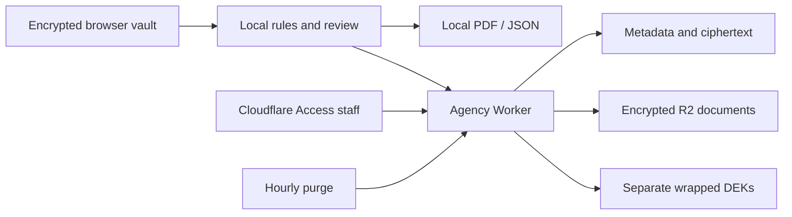

# Architecture and implementation choices

The workspace contains pure rules, strict form schemas, portable WebCrypto and DOM-free PDF packages; two React/Vite SPAs; and a Hono Worker with D1/R2 adapters. Packages stay private in v1; consumers build from source. Production has one agency per deployment. No hosted renter account or backend profile store exists.

API routes are in `apps/inbox-worker/src/app.ts`, storage interfaces in `storage/ports.ts` and encryption in `crypto/envelope.ts`. External JWT and Turnstile behavior is injectable. Tests run the real routes in workerd and use generated JWKS. No test contacts Access, Turnstile or production storage.

Choices where PLAN.md needed interpretation:

- `buildPayload` takes document metadata as an explicit `documents` argument. The specified profile has no document field, so selected IDs alone cannot resolve hashes/types. Files remain separate.
- Correction messages and collection-notice hash receipts have separate migrations, since the required features had no table in the plan.
- Published listings are immutable; edit drafts and create another listing for changed requests. This prevents changing what an existing application consented to.
- Final decisions made before an agreement date keep the legal deadline unknown and use a short policy deadline, rather than inventing an agreement date.
- Global successful-handoff settings are capped at 90 days for both jurisdictions, a conservative kit cap.
- Open/unprocessed applications have a 90-day kit safety cap, because the plan omitted abandoned open listings. This is policy, not a claimed statutory period.
- Purge batches select five applications and ten documents to bound each invocation. Production requires Workers Paid; a 25-application batch cannot be assumed to stay within 50 D1 queries.
- The plan’s UTC-midnight legal deadline representation is retained; operational policy has a two-day buffer. UTC midnight is later than Australian local midnight, contrary to the plan’s explanatory sentence. Do not represent it as “10 hours early”. NSW improper-collection policy is immediate, avoiding weekend/holiday ambiguity; the calculator’s business-day cap skips weekends only.
- Rules versions are generated SHA-256 constants from canonical registry and policy JSON, preserving a synchronous pure rules API without adding a runtime hashing dependency. Generated checks detect stale output.
- Consent hashes cover versioned template text; agency/premises interpolation is reproducible from the encrypted listing snapshot. Collection-notice hash is recorded separately.
- Full font embedding is used: the planned Noto fonts with pdf-lib subsetting produced missing glyphs in Poppler despite successful text extraction. Visual review covers both jurisdictions; full fonts increase export size.
- Font assets are vendored under OFL. Frontend builds emit self-hosted fonts; the Worker never renders PDFs.

- All assets run through the Worker so dynamic Turnstile/CORS CSP settings apply to HTML responses too; each standalone SPA also ships strict static `_headers`.
- Static assets use `html_handling: none`: automatic HTML canonicalisation otherwise redirects the staff index fallback back to itself.
- Development staff assets are available on loopback before choosing a fixture identity; development API requests still require the explicit example identity header. This resolves the plan’s bootstrap loop: a browser navigation cannot attach that custom header before loading the login form. Production assets remain Access-gated.

No cloud resources were created and nothing was deployed by this change. PLAN.md remains unchanged. Outstanding product defaults and legal questions remain for maintainers to review.
