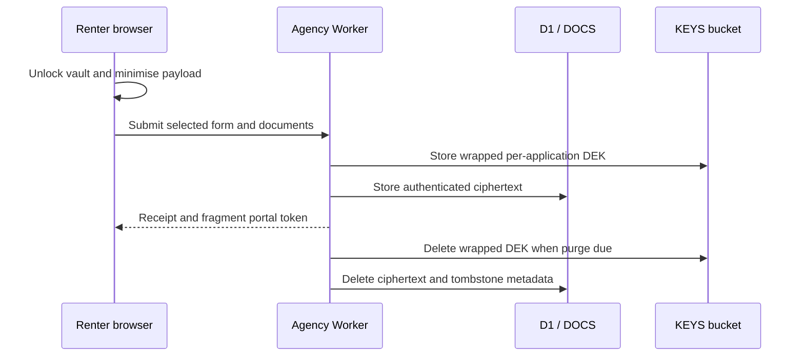

# Privacy design

The project receives no renter profile. A static renter app encrypts local records/documents/submission history in IndexedDB. Only an explicit submission sends selected information to the deploying agency. Manual exports are shared by the renter independently.

AES-GCM uses a new 12-byte IV for every message and AAD `aurak:v1:{applicationId}:{purpose}`. DEKs are wrapped with a 32-byte AES-KW KEK; the current key ID selects the secret. Key rewrap uses a conditional R2 write. Vault AAD binds each record to its store/key. Keys are never stored in plaintext alongside ciphertext.

Threats and controls: storage dumps expose ciphertext; stolen staff sessions are constrained by Access/MFA, verified JWT, roles and audit; submissions have strict schemas with no custom questions; file magic and size limits reject unsupported uploads; downloads are attachments under sandbox CSP; public operations have optional rate limiting/Turnstile; CSRF requires matching Origin and JSON on staff mutations; logs admit only fixed fields. Malicious documents are never parsed by the Worker. The app has no analytics or AI features.

Audit is append-only through SQLite triggers (tested in D1). Every staff application read/download/export is logged. Agents see their own audit events; admins see all. Records contain IDs/actions, never renter names or contents. Audit rows are retained indefinitely in v1; whether they are truly de-identified remains legal question L18.

| Event                  | Kit default                                               | Legal constraint / caveat                                                        |
| ---------------------- | --------------------------------------------------------- | -------------------------------------------------------------------------------- |
| VIC unsuccessful       | agreement +14 days                                        | +30 days; written other-premises consent permits +6 months; policy buffer 2 days |
| NSW unsuccessful       | agreement +14 days                                        | statutory maximum regulations pending, UNVERIFIED                                |
| Successful handoff     | agreement +30 days                                        | VIC cap tenancy end +3 years if known; agency must export to tenancy system      |
| Withdrawn application  | +2 days                                                   | configurable up to 7 days                                                        |
| Withdrawn listing      | +14 days                                                  | legal trigger unclear, L5                                                        |
| Identity copies        | verification/final decision immediately or upload +7 days | NSW sight-don’t-store guidance; document-only caveat below                       |
| Improper collection    | immediate                                                 | NSW pending rule: 2 business days; weekends only in calculator                   |
| Still-open application | 90 days                                                   | additional kit safety cap, not statutory law                                     |

Application purge deletes the wrapped DEK before ciphertext, deletes rows and writes a non-PII tombstone, receipt and audit event. Retrying after an R2 failure requires no plaintext. Purged applicant tokens are invalidated. Late receipts compare the execution time against the encoded legal deadline. Alert monitoring and external downloads remain the agency’s responsibility.

D1 Time Travel cannot be disabled and may retain ciphertext for 7/30 days. R2 internal deletion/replication retention is UNVERIFIED. A previously cached or copied DEK cannot be recalled. Document-only purge deletes R2 ciphertext but keeps the shared application DEK; it does not promise individual cryptographic erasure. Loss of the KEK is unrecoverable. KEK backups and exported plaintext require separate operator controls. Consult L7/L18/L19/L21 before relying on the legal effect of deletion, audit retention, portal notices or offshore storage.

Browsers may evict IndexedDB. Persistent storage is best effort; encrypted backups and a strong passphrase are essential. Auto-lock releases references to keys and plaintext UI state; JavaScript cannot guarantee immediate memory erasure. No service worker caches PII. CSP avoids third-party resources except explicitly enabled Turnstile. Standalone renter sites must configure trusted agency origins in their CSP and agencies must allow the renter origin in CORS.
